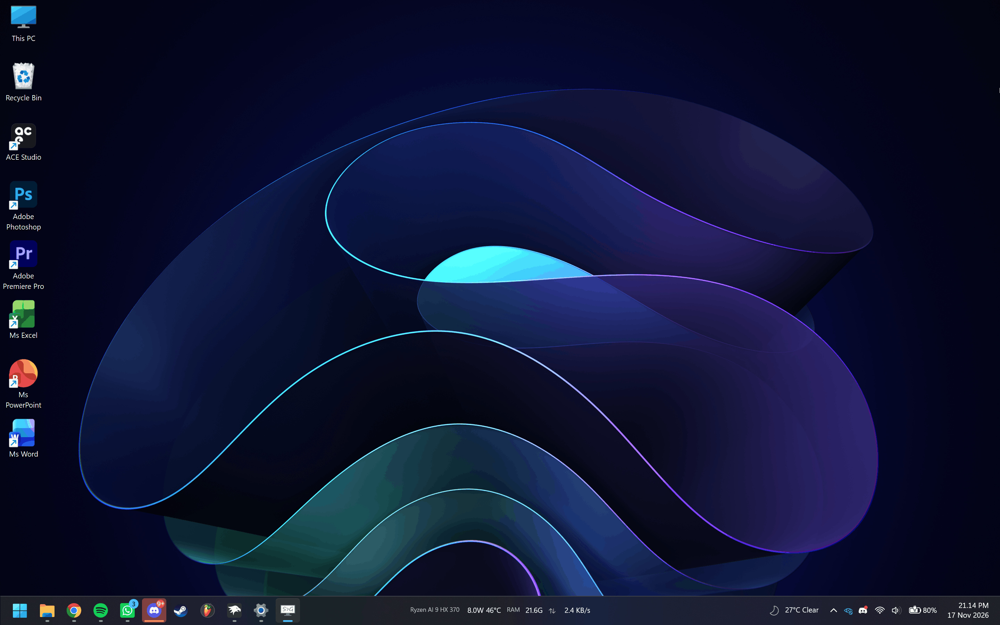

# Taskbar System Monitor

Live readings on the Windows 11 taskbar: CPU, GPU, RAM, disk, network,
battery, temperatures and more. Click a reading for details.

## Quick start

1. Install the mod. The defaults already work.
2. Right-click the taskbar, then **System Monitor settings**.
3. On the **Readings** page, drag readings to move them, click one for its
   options, and use a zone's **+** to add more. Changes show at once.

Want a ready-made look? **Presets** sets everything up in one click, and
Undo takes it back. Prefer typing? Switch the page to **Text** and write
names separated by commas, such as `cpu, ram, battery`. Small typos
(`cpuu`) and everyday words (`memory`) are understood.

## Readings

| Name | Shows | Name | Shows |
| --- | --- | --- | --- |
| `cpu` | CPU usage | `cputemp` | CPU temperature |
| `gpu` | GPU usage | `gputemp` | GPU temperature |
| `ram` | System memory | `vram` | GPU memory |
| `down` | Download speed | `up` | Upload speed |
| `net` | Download + upload | `usage` | Data used today |
| `usagemonth` | Data used this month | `connection` | Wi-Fi 7, Ethernet... |
| `cpupower` | CPU power | `gpupower` | GPU power |
| `battery` | Charge level | `batterypower` | Watts in or out |
| `batterytime` | Time to empty or full | `batteryhealth` | Capacity vs. new |
| `disk` | Disk activity or speed | `fan` | Fan speed |
| `totalpower` | Whole-machine watts | `ping` | Round trip, in ms |
| `currency` | Exchange rate | `weather` | Temperature and sky |

`|` draws a divider line.

**Two GPUs?** Put `i` (integrated) or `d` (discrete) before any GPU name:
`igpu`, `dgpu`, `dgputemp`, `ivram`, and so on. Plain `gpu` follows the
adapter with the most dedicated memory that is currently on.

## Good to know

- **Details panel**: click a reading (or, in settings, rest the pointer on
  it) to open details, a usage report and a Task Manager button.
- **Right-click a reading** to open the settings page that fits it, such
  as Network, Weather, Battery or Sensors.
- **Move the widget**: set a hotkey under **Position**, press it, drag the
  widget (also onto another monitor), then **Enter** to save or **Esc** to
  cancel.
- **Settings page in Windhawk**: only two switches, to open the settings
  window if the taskbar menu entry is missing, and to reset the window's
  choices if the widget became hard to see.

## Temperatures, power and fans

Windows has no reliable CPU temperature, so for accurate readings run
[HWiNFO](https://www.hwinfo.com) (Sensors-only is enough) and turn on
**Shared Memory Support**. HWiNFO's free version switches it off after 12
hours; the mod then falls back to other sources. ASUS laptops report fan
speeds without HWiNFO; other laptops need it, or `fan` shows `-- RPM`.

## Internet use

The mod does not go online by default. It goes online only for the items
below, and only while they are shown or in use:

- `ping`: ICMP packets to the address you set (1.1.1.1 by default). Opening
  the Network details panel also pings that address while the panel is open.
- `currency`: api.frankfurter.dev, about once an hour.
- `weather`: api.open-meteo.com (or api.openweathermap.org with your key),
  every 30 minutes, using your coordinates rounded to about 1 km. Finding
  your place may use Windows location. If that is off, an approximate place
  comes from ipinfo.io. With no city typed, the rounded coordinates are
  sent to nominatim.openstreetmap.org to get a place name. Typed cities use
  geocoding-api.open-meteo.com and nominatim.openstreetmap.org.
- **Speed test** (only when you start one): speed.cloudflare.com, using
  6 parallel streams for about 10 s down and 8 s up. This can use hundreds
  of MB. On a metered connection the first click only warns; click again
  within 15 s to run it anyway. Each test also asks
  ipinfo.io for your ISP name.

Nothing else is sent. Every request uses HTTPS (ping uses ICMP), the mod
asks for no administrator rights and opens no port. Settings are kept only
in Windhawk's mod storage; nothing is written to `%APPDATA%`.

## Privacy Mode

Privacy Mode masks network and weather values with `******`. Turn it on in
the settings window. Optionally (off by default) it can switch on by itself
while a screen recorder, streaming or meeting app (OBS, Zoom, Teams and
similar, plus names you add) is running. To detect them, the mod checks the
process list every few seconds while that option is on.

## Troubleshooting

| You see | Try |
| --- | --- |
| `--` on a reading | The source is unavailable. Add `?` after the name to hide it (`gpu?`). |
| Wrong or missing CPU temperature | Run HWiNFO with Shared Memory Support. |
| No widget | Remove readings, lower the font size, or move it. |
| No widget after a Windows update | Wait a few seconds, or right-click the taskbar. |
| A zone is small or elsewhere | The taskbar is too full. Remove or join readings. |
| Boxes instead of icons | Turn icons off in settings. |
| `weather` or `currency` stays `--` | Check your internet connection. |
| Weather for the wrong city | Type your city under **Weather ▸ Location**. |

The **About** page in the settings window has a log, and **Copy with PC
details** puts it on the clipboard for a bug report. For more detail turn
on **Advanced logs** there (off by default).

## Compatibility

- Made for the bottom Windows 11 taskbar. Vertical taskbars are not
  supported.
- Icons need the Segoe Fluent Icons font that ships with Windows 11.
- Works with other Windhawk taskbar mods in most cases; the combinations
  noted in the full reference are untested.

## Credits and license

Based on
[Taskbar System Info](https://github.com/starychenko/windhawk-taskbar-system-info)
by Yevhenii Starychenko. Modified by Wcm1D (November 2026): new Items
setting with zones, repeated entries and per-entry formats, dock-style
layouts, integrated and discrete GPU readings, CPU and GPU power, disk and
fans, battery readings and shapes, data usage with reports, connection type,
exchange rate, weather, details on hover, and a settings window with a
drag-and-drop taskbar preview.

Taskbar discovery and thread dispatch follow
[Multirow taskbar for Windows 11](https://github.com/ramensoftware/windhawk-mods/blob/main/mods/taskbar-multirow.wh.cpp)
by Michael Maltsev (`m417z`). Native GPU temperature collection follows his
[Taskbar Clock Customization implementation](https://github.com/m417z/my-windhawk-mods/commit/861920df6380f4c13abec5d9226362c4725e8362).
Secondary-taskbar discovery is adapted from
[Taskbar Fluent Media Player](https://github.com/Salyts/Taskbar-Fluent-Media-Player)
by Salyts.

Weather icons: [Fluent UI System Icons](https://github.com/microsoft/fluentui-system-icons),
Copyright (c) 2020 Microsoft Corporation, MIT License (notice in the source).

Data: exchange rates are the European Central Bank's reference rates via
[Frankfurter](https://frankfurter.dev). Weather data by
[Open-Meteo.com](https://open-meteo.com) (CC BY 4.0) or
[OpenWeatherMap](https://openweathermap.org); approximate location by
[IPinfo](https://ipinfo.io); place names from
[OpenStreetMap](https://www.openstreetmap.org/copyright) (Nominatim, ODbL).

ASUS fan readings use the values found by
[G-Helper](https://github.com/seerge/g-helper) (GPL-3.0).

Released under [GPL-3.0](https://www.gnu.org/licenses/gpl-3.0.html), like
the original.
*/
// ==/WindhawkModReadme==
